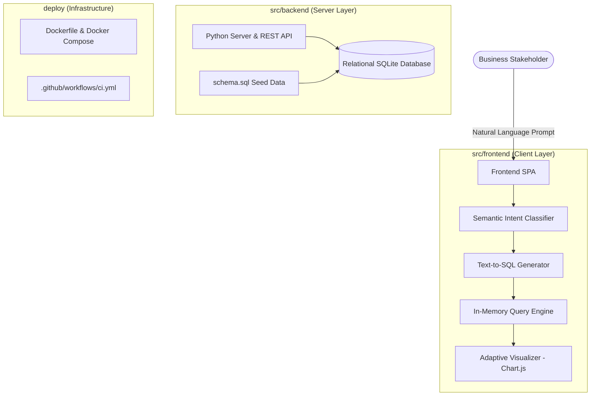

# 📊 Business Analytics Platform

> Enterprise Conversational Business Intelligence & Semantic Text-to-SQL Analytics Platform.  
> Inspired by modern clean architecture standards and high-density enterprise SaaS solutions.

<p align="left">
  <a href="https://github.com/thienlotus/business-analytics-platform/actions"></a>
  <a href="LICENSE"></a>
  
  
  
  
</p>

---

## 📑 Table of Contents

- [Overview](#-overview)
- [Architecture & Design](#-architecture--design)
- [Project Structure](#-project-structure)
- [Key Features](#-key-features)
- [Getting Started](#-getting-started)
  - [Option 1: Direct Browser Run (Zero Config)](#option-1-direct-browser-run-zero-config)
  - [Option 2: Run via Python Backend](#option-2-run-via-python-backend)
  - [Option 3: Run via Docker Compose](#option-3-run-via-docker-compose)
- [Database Schema](#-database-schema)
- [Learning & Interview Guide](#-learning--interview-guide)
- [Tech Stack](#-tech-stack)
- [Author & License](#-author--license)

---

## 📌 Overview

**Business Analytics Platform** is a conversational analytics tool built for business decision-makers. It enables stakeholders to ask business questions in natural language (Vietnamese/English), automatically translates those questions into optimized SQL queries, executes them against an enterprise relational database, and dynamically renders interactive multi-dimensional visualizations.

---

## 🏛️ Architecture & Design

The platform emphasizes a clean separation of concerns, dividing the solution into independent **Frontend (SPA)**, **Backend (REST & Database)**, and **Deployment Orchestration** layers.



> 📖 **Read the full design specification:** [docs/architecture.md](docs/architecture.md)

---

## 📂 Project Structure

```text
business-analytics-platform/
├── .github/
│   └── workflows/
│       └── ci.yml               # Automated Continuous Integration (CI)
├── deploy/
│   ├── Dockerfile               # Production Docker container
│   └── docker-compose.yml       # Container orchestration
├── docs/
│   ├── architecture.md          # In-depth architectural design specification
│   └── ai-learning-guide.md     # Comprehensive Text-to-SQL study & interview guide
├── src/
│   ├── backend/                 # Python backend service & relational database
│   │   ├── server.py            # HTTP API server & static host
│   │   ├── schema.sql           # 5-table schema definition & realistic seed dataset
│   │   └── requirements.txt     # Backend runtime dependencies
│   └── frontend/                # Enterprise Single Page Application
│       ├── index.html           # High-density, clutter-free dashboard workspace
│       ├── css/
│       │   └── style.css        # Precision design tokens (subtle 4px-6px radius)
│       └── js/
│           ├── app.js           # UI state controller, chart lifecycle & exports
│           ├── database.js      # Relational query processor & schema metadata
│           └── text_to_sql.js   # Semantic NLP parser & Explainable AI engine
├── .env.example                 # Environment configuration template
├── .gitignore                   # Strict build & cache hygiene
├── LICENSE                      # MIT Open Source License
└── README.md                    # Root project documentation
```

---

## ✨ Key Features

- **Semantic Text-to-SQL Engine:** Converts conversational queries into verified, read-only SQL queries with zero latency.
- **Adaptive Visualizations:** Dynamically switches between Line Charts (trends), Bar Charts (comparisons), Doughnut Charts (shares), and Data Tables.
- **Precision Enterprise UI:** Subtle 4px - 6px sharp radius, dark high-contrast obsidian palette, and zero visual clutter.
- **SQL Inspector & Playground:** View auto-generated queries, copy with 1-click, or execute custom ad-hoc SQL queries directly.
- **Schema Inspector:** Interactive schema browser mapping 5 relational tables and foreign key relationships.
- **1-Click CSV Export:** Export filtered data sets into UTF-8 CSV reports for downstream analysis.

---

## 🚀 Getting Started

### Option 1: Direct Browser Run (Zero Config)
Because the platform includes a standalone client-side relational engine, you can run it immediately without starting any server:
```bash
git clone https://github.com/thienlotus/business-analytics-platform.git
cd business-analytics-platform
# Open src/frontend/index.html in any browser (Chrome, Edge, Firefox, Brave)
```

### Option 2: Run via Python Backend
```bash
git clone https://github.com/thienlotus/business-analytics-platform.git
cd business-analytics-platform
python src/backend/server.py
```
Open your browser and navigate to: **`http://localhost:8080`**.

### Option 3: Run via Docker Compose
```bash
cd deploy
docker-compose up --build -d
```

---

## 🗄️ Database Schema

The system includes a realistic Vietnamese E-commerce dataset with 5 interrelated tables:

```text
[ categories ] ──(1:N)──► [ products ] ──(1:N)──► [ order_items ]
                                                        │
                                                       (N:1)
                                                        │
[ customers ] ────────────(1:N)──────────────► [ orders ]
```

1. **`categories`**: Product classifications (Smartphones, Laptops, Audio, Smartwatches, Smart Home).
2. **`products`**: Unit costs, selling prices, stock inventory, and customer ratings.
3. **`customers`**: Profiles, tiers (VIP, Loyal, Regular, New), and regional metadata.
4. **`orders`**: Timestamps, gross amounts, discounts, net revenue, payment gateways, and delivery statuses.
5. **`order_items`**: Line items, quantities, and line subtotals.

---

## 📖 Learning & Interview Guide

A dedicated engineering guide is included for candidates and developers preparing for technical interviews:  
👉 **[docs/ai-learning-guide.md](docs/ai-learning-guide.md)**

Topics covered:
* The 4-stage pipeline from natural language to SQL.
* Guardrails and security considerations for conversational analytics.
* Top 3 technical interview questions with model answers.

---

## 🛠️ Tech Stack

* **Frontend:** Vanilla HTML5, High-performance CSS3, Modern ES6+ JavaScript, Chart.js, Lucide Icons.
* **Backend:** Python 3.11, SQLite3, RESTful APIs.
* **DevOps / CI/CD:** Docker, Docker Compose, GitHub Actions.

---

## 👨‍💻 Author & License

Developed with ❤️ by **Lê Vũ Thiên (@thienlotus)**.  
Released under the [MIT License](LICENSE).
