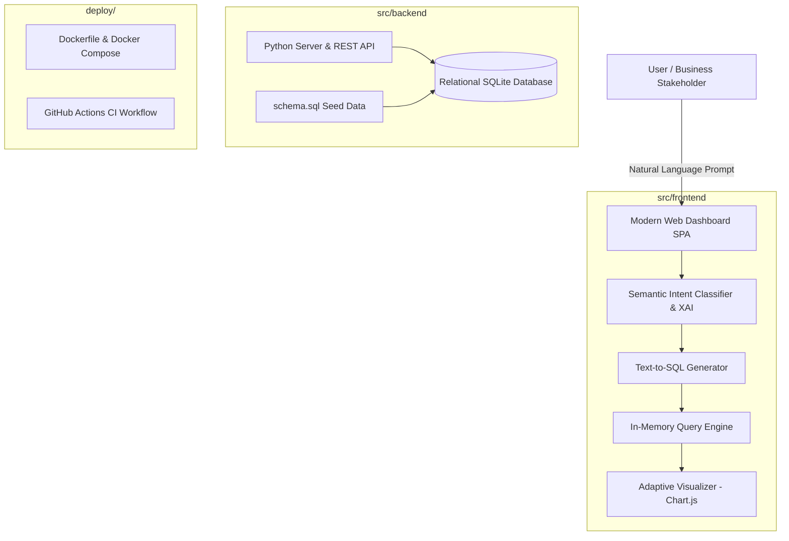

# System Architecture & Design Documentation
> Enterprise Conversational Business Intelligence & Text-to-SQL Architecture  
> Author: **Le Vu Thien (@thienlotus)**

---

## 1. High-Level Architecture Overview



---

## 2. Directory Layout & Separation of Concerns

The codebase follows the enterprise clean layout inspired by modern solutions architects:

```text
├── .github/
│   └── workflows/
│       └── ci.yml               # Automated Continuous Integration
├── deploy/
│   ├── Dockerfile               # Production container definition
│   └── docker-compose.yml       # Multi-container orchestration
├── docs/
│   ├── architecture.md          # Architecture & system design specification
│   └── ai-learning-guide.md     # In-depth technical interview & study guide
├── src/
│   ├── backend/                 # Python backend service & relational database
│   │   ├── server.py            # HTTP API server & static host
│   │   ├── schema.sql           # 5-table schema definition & realistic seed dataset
│   │   └── requirements.txt     # Backend runtime dependencies
│   └── frontend/                # Enterprise Single Page Application
│       ├── index.html           # High-density, clutter-free dashboard workspace
│       ├── css/
│       │   └── style.css        # Precision design tokens (subtle 4px-6px radius)
│       └── js/
│           ├── app.js           # UI state controller, chart lifecycle & exports
│           ├── database.js      # Relational query processor & schema metadata
│           └── text_to_sql.js   # Semantic NLP parser & Explainable AI engine
├── .env.example                 # Environment configuration template
├── .gitignore                   # Strict hygiene for build artifacts & cache
├── LICENSE                      # MIT Open Source License
└── README.md                    # Root project documentation
```

---

## 3. Core Design Principles

1. **Precision UI Aesthetics:** 
   * Subtle sharp corner radius (`4px - 6px`).
   * No oversized "AI pill" bubbles or distracting visual clutter.
   * High information density suitable for data analysts and business leaders.

2. **Zero-Configuration Standalone Mode:**
   * The frontend can run directly in any web browser without starting a server, while also supporting production containerized deployment.

3. **Multi-layer Guardrails:**
   * Read-only execution policy preventing destructive DDL/DML queries.
   * Execution time tracking with millisecond precision (`< 15ms`).
